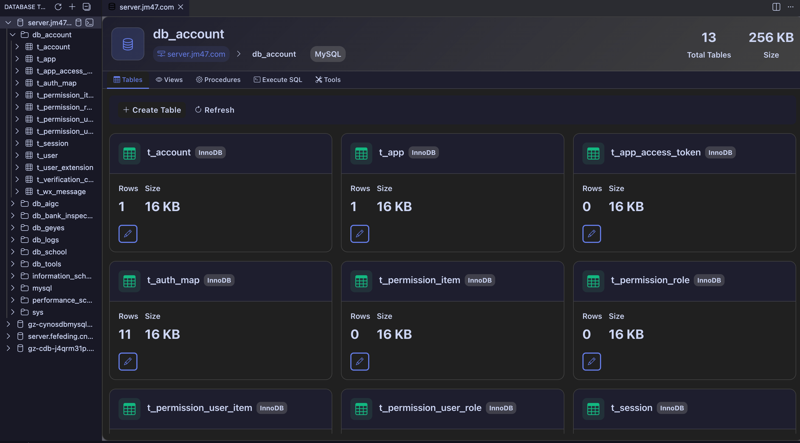

# fdb2 - Cross-Platform Database Management Tool

[中文](README_zh.md) | English

> 🚀 A lightweight, open-source database management tool supporting 9+ database types, providing a Navicat Premium-like professional experience — completely free and running locally!



## 🔥 Core Features

### 🌐 Multi-Database Support
- **9+ Database Types**: MySQL, PostgreSQL, SQLite, SQL Server, Oracle, CockroachDB, MongoDB, SAP HANA, ClickHouse
- **Compatibility Extensions**: MariaDB/TiDB/Aurora compatible with MySQL, Aurora PostgreSQL compatible with PostgreSQL
- **NoSQL Support**: MongoDB document database

### 🎯 Professional Features
- **Connection Management**: Visual configuration, one-click testing, secure local storage
- **Structure Browsing**: Complete display of tables, indexes, foreign keys, views, stored procedures
- **Data Operations**: Full CRUD operations, conditional queries, pagination, batch import/export
- **SQL Editor**: Syntax highlighting, auto-completion, formatting, query history
- **Performance Monitoring**: Real-time connection status, query performance analysis, slow query detection

### ⚡ Key Advantages
- **Zero Configuration**: Ready to use immediately after global installation
- **Cross-Platform**: Full compatibility with Windows, macOS, and Linux
- **Lightweight & Efficient**: Minimal resource usage, fast startup
- **Local Storage**: All data stored locally, secure and reliable
- **Offline Usage**: Manage local and remote databases without internet
- **Fully Open Source**: MIT license, free to use and contribute

## 🚀 Quick Start

### 📥 Installation Options

#### 💻 Desktop Client (Recommended)
Download the pre-built cross-platform desktop application for immediate use:
- **[Windows / macOS / Linux Client Download](https://github.com/fefeding/fdb2/releases/)**
- Unzip and double-click to run, no environment setup required

#### 📦 Command Line Tool
Install globally via npm/yarn/pnpm:
```bash
# npm (recommended)
npm install -g fdb2

# yarn
yarn global add fdb2

# pnpm
pnpm add -g fdb2
```

### ▶️ Start Service

```bash
# Start the database management tool
fdb2 start

# Start with custom port
fdb2 start -p 8080

# Stop service
fdb2 stop

# Check service status
fdb2 status

# Restart service
fdb2 restart
```

### 🌐 Access Application

After successful startup, open in your browser (check startup logs for the actual port):
```
http://localhost:9800
```

> 💡 **Tip**: Default port is 9800, but if occupied, it will automatically select another available port

## 🌍 Remote Database Access (HTTP Proxy)

Sometimes the database is **not reachable from your machine** — it sits behind a corporate VPN, on a private subnet, or on a bastion host. In that case, run `fdb2` on a machine that *can* reach it and let your local client talk to that service over HTTP.

### How it works
Add a connection of type **Remote Proxy Service** and point it at the remote `fdb2` server. Once saved, **every database connection configured on that remote server is merged into your local connection list**, and every operation — browsing schemas, running SQL, DDL, data CRUD, export, even editing or deleting the connection config — is forwarded to the remote server and executed there.

The remote database password never leaves the remote server: it is **not** sent down to your client.

### Setup
1. **On the machine that can reach the database**, start the service and confirm it is reachable from your client:
   ```bash
   fdb2 start -p 9800
   # then open http://<remote-ip>:9800 in a browser to confirm
   ```
2. **On that remote service**, add the real database connections as usual.
3. **On your local client** (web UI or the VSCode extension) → *Add Connection* → **Type: Remote Proxy Service**:

   | Field | Description |
   | --- | --- |
   | Service URL | Base URL of the remote `fdb2` server, e.g. `http://10.0.0.5:9800` — the **root** of the service, without a trailing `/api`. |
   | Access Token | Optional. Only needed when the remote server was started with `DB_TOOL_REMOTE_TOKEN`. |

4. **Save.** The remote connections now appear in your local connection list — expand, query, and edit them exactly like local ones. Editing or deleting one of those remote connections applies to the remote server's configuration.

### Securing the remote service
```bash
# on the remote machine
DB_TOOL_REMOTE_TOKEN=your-secret fdb2 start -p 9800

# 也可以把令牌持久化保存，之后 `fdb2 start` 会自动读取，无需每次设置环境变量：
fdb2 token set your-secret
fdb2 start -p 9800
# 查看已保存的令牌：
fdb2 token get
```
Once set, the remote server rejects every HTTP request that does not carry the matching `x-db-tool-token` header, and answers `远程访问令牌无效` (*invalid remote access token*). Put the same value into the proxy connection's **Access Token** field.

> ⚠️ Set the token **only on the remote server**. Setting it on your own local server would also lock out your local browser/extension.
> The token guards the HTTP entry point only; in-process calls (e.g. from the VSCode extension host) are not affected.

### Notes & limits
- The remote service must be reachable from your client (LAN IP, VPN, SSH tunnel, …).
- Proxying is **one level deep** — a chain `A → B → C` is not supported.
- If the remote service is unreachable, the proxy entry exposes no connections and the connection detail panel shows the error.
- The remote server keeps its own database credentials; the local client only stores the proxy URL and token.

## 🔌 VSCode Extension

Prefer staying inside the editor? `fdb2` also ships as a **VSCode extension** — "Database Tool (fdb2)" — that embeds the same UI directly in VSCode.

- **Native tree navigation** — a dedicated **Database Tool** view in the Activity Bar (Connection → Database → Table → Column). Click any node to open the related panel.
- **Per-connection tabs** — the same connection reuses one editor tab while different connections open new tabs, so you can compare databases side by side.
- **Rich content area** — connection overview, database detail, paginated table data (with a one-line pagination + page-size bar), table structure (columns/indexes/foreign keys/SQL), and a full SQL query panel (`Ctrl/Cmd+Enter` to run).
- **Shared config** — connections are stored at `~/.fdb2/connections.json` and reused by both the desktop app and the extension (override with the `dbtool.dataDir` setting).
- **Supported databases** — MySQL, PostgreSQL, SQL Server, SQLite, Oracle, CockroachDB, MongoDB, SAP HANA, ClickHouse (Oracle/SQLite/SAP HANA need native drivers compiled for VSCode's Node ABI).

Install from the Marketplace (`Ctrl/Cmd+Shift+X` → search **"Database Tool (fdb2)"**), or build from source:

```bash
cd packages/vscode && npm install && npm run build
# then press F5 in VSCode to launch the Extension Development Host
```

> For full setup, operations, settings, native-driver notes, and publishing, see [**packages/vscode/README.md**](packages/vscode/README.md).

## 📊 Supported Database Types

| Database Type | Default Port | Key Features |
|--------------|-------------|-------------|
| **MySQL** | 3306 | Stored procedures, triggers, views, full-text search, partitioning |
| **PostgreSQL** | 5432 | Stored procedures, triggers, views, JSON/JSONB, window functions |
| **SQLite** | - | Lightweight file-based database, zero configuration, embedded |
| **SQL Server** | 1433 | T-SQL, stored procedures, CLR integration, AlwaysOn |
| **Oracle** | 1521 | PL/SQL, RAC, Data Guard, advanced security |
| **CockroachDB** | 26257 | Distributed SQL, strong consistency, automatic sharding |
| **MongoDB** | 27017 | NoSQL document database, aggregation pipeline, indexing |
| **SAP HANA** | 39013 | In-memory database, real-time analytics, column store |
| **ClickHouse** | 8123 | Columnar store, real-time analytics, MergeTree engine, HTTP interface |

### 🔄 Compatibility Notes
- **MariaDB/TiDB**: Compatible with MySQL protocol — select MySQL type
- **Amazon Aurora MySQL**: Compatible with MySQL — select MySQL type
- **Amazon Aurora PostgreSQL**: Compatible with PostgreSQL — select PostgreSQL type
- **Better-SQLite3**: Compatible with SQLite — select SQLite type
- **ClickHouse**: Connect via the HTTP interface (default port 8123) using Basic auth with the default user `default`; supports table/view browsing, schema inspection, data CRUD, SQL queries, backup and restore

## 🤝 Contribution Guide

Contributions are welcome! Code contributions, bug reports, or feature suggestions are all appreciated.

### Development Environment Setup
```bash
# Clone repository
git clone https://github.com/fefeding/fdb2.git
cd fdb2

# Install dependencies
pnpm install

# Start development server
pnpm dev

# Build production version
pnpm build
```

### Contribution Workflow
1. Fork the project
2. Create a feature branch (`git checkout -b feature/your-feature`)
3. Commit changes (`git commit -am 'Add some feature'`)
4. Push to branch (`git push origin feature/your-feature`)
5. Create Pull Request

## 📄 License

This project is licensed under the [MIT License](LICENSE) — fully open source and free to use.

## 🙏 Acknowledgments

Thanks to all contributors and users for their support! Special thanks to the following tech stack:
- Vue 3 + TypeScript
- Vite build tool
- Bootstrap 5 UI framework
- vue-i18n internationalization
- Pinia state management

---

**Enjoy using fdb2 Database Management Tool! For any issues, please report at [GitHub Issues](https://github.com/fefeding/fdb2/issues).**

<!-- Chinese version available at [README_zh.md](README_zh.md) -->
