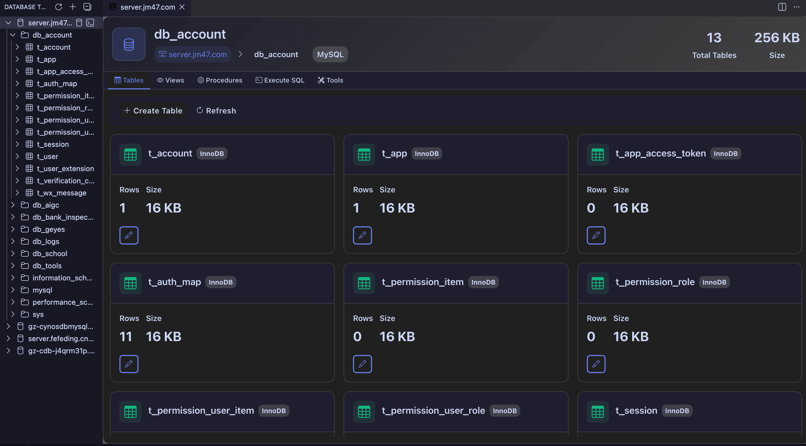
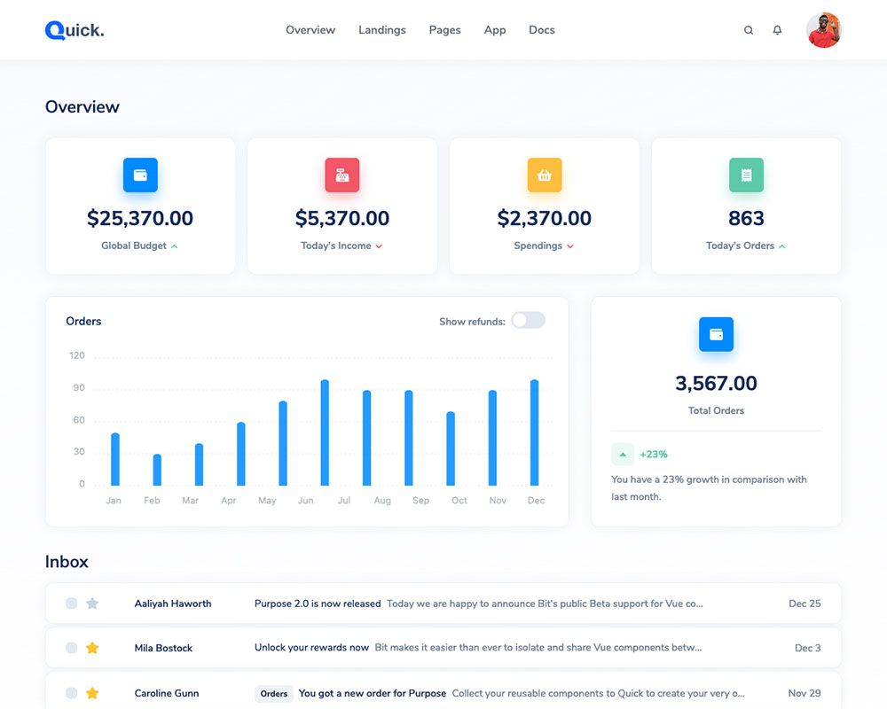
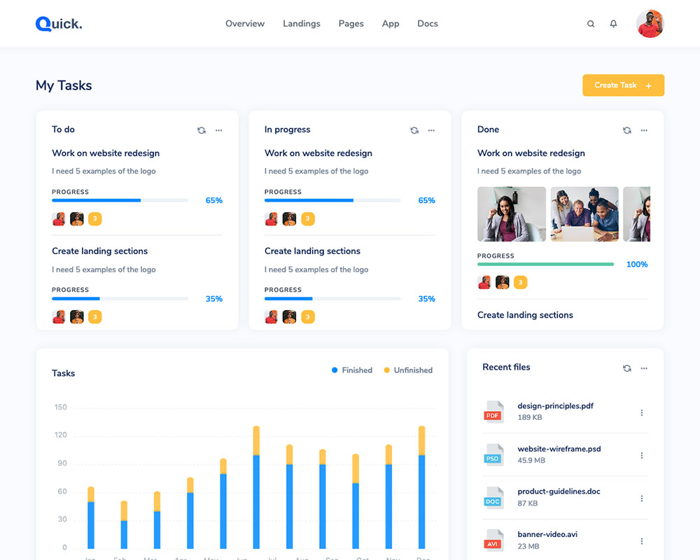

# Database Tool (fdb2) — Database Client & SQL Editor for VS Code

**A free, open-source database client for VS Code.** Connect to MySQL, PostgreSQL, SQLite, SQL Server, MongoDB, Oracle, ClickHouse, CockroachDB and SAP HANA; browse schemas, run SQL queries, edit table data and export CSV **without ever leaving VSCode**. One extension instead of a separate client for every database — a lightweight alternative to standalone tools such as DBeaver or Navicat.



- **SQL editor + database explorer in one place** — a native Activity Bar tree (Connection → Database → Table → Column) plus a full workbench webview.
- **One client for 9+ databases** — SQL and NoSQL, see the supported databases table below.
- **Data grid, not just a query console** — pagination, sorting, WHERE filters, insert/edit/delete rows and CSV export.
- **Free & open source** — MIT licensed; connection settings stay on your machine in `~/.fdb2/connections.json`.
- **Works with the desktop app** — the same `fdb2` UI and connection config are available as a [desktop app / CLI](https://github.com/fefeding/fdb2#readme) for Windows, macOS and Linux.

---

## ✨ Features

- **Connection management** — Add / edit / delete / test connections from the Activity Bar's **Database Tool** view. Connection config is shared with the desktop `fdb2` app under `~/.fdb2/connections.json` (overridable via the `dbtool.dataDir` setting).
- **Remote proxy connections** — Point a connection at a remote `fdb2` server over HTTP and work with the databases that server exposes, even when they are unreachable from this machine (see *Connect through a remote service* below).
- **Object explorer tree** — A native VSCode tree: **Connection → Database → Table → Column**. Click any node to open the related panel.
- **Per-connection tabs** — Clicking the *same* connection (or its databases/tables) reuses the same editor tab; clicking a *different* connection opens a brand-new tab, so you can compare multiple databases side by side.
- **SQL query** — A dedicated query panel that executes arbitrary SQL and renders results as a sortable, paginated table (`Ctrl/Cmd+Enter` to run).
- **Data browsing & editing** — Paginated table data with WHERE filtering, row insert/edit/delete, and CSV export.
- **Table structure** — Inspect columns, types, primary keys, indexes, foreign keys and relationships.
- **Supported databases** — 9+ engines in one client, see the table below.

---

## 🗄️ One client for 9+ databases

| Database | Driver | Notes |
| --- | --- | --- |
| MySQL (MariaDB / TiDB via the MySQL protocol) | pure JS | works out of the box |
| PostgreSQL, CockroachDB | pure JS | works out of the box |
| SQL Server (MSSQL) | pure JS | works out of the box |
| MongoDB (NoSQL / document store) | pure JS | works out of the box |
| ClickHouse | HTTP, pure JS | default port `8123`, Basic auth |
| SQLite (`.db` / `.sqlite`) | native | `better-sqlite3` / `sqlite3` |
| Oracle | native | `oracledb` |
| SAP HANA | native | `@sap/hana-client` (experimental) |

Oracle / SQLite / SAP HANA require native drivers compiled for VS Code's Node ABI — see *Native drivers* below.

---

## 🖼️ Screenshots

The same `fdb2` web workbench runs inside the VS Code panel — connection browser, SQL editor and the sortable data grid, all without leaving the editor:





---

## 📥 Installation

### From the Marketplace (recommended)
[Install from the VS Code Marketplace](https://marketplace.visualstudio.com/items?itemName=fefeding.vscode-fdb2), or search for **"Database Client (fdb2)"** in the VSCode Extensions view (`Ctrl/Cmd+Shift+X`) and click **Install**. The extension is also published on Open VSX for VS Code forks.

Building from source? See the *For contributors* section at the end of this page.

---

## 🚀 Getting Started

### 1. Open the Database Tool view
Click the **Database Tool** icon in the Activity Bar (left side). If you don't see it, open the Command Palette (`Ctrl/Cmd+Shift+P`) and run **`Database Tool: Add Connection`** — that will reveal the view automatically.

The tree starts empty with a welcome view: *"No database connections yet."* plus an **Add Connection** button.
You can also collapse/expand everything with the tree's **Collapse All** action.

### 2. Add a connection
There are three ways to open the **Add Connection** form:
- Click the **`+`** button at the top of the Database Tool view.
- Right-click empty space in the tree and choose **Add Connection**.
- Run the command **`Database Tool: Add Connection`** from the Command Palette.

Fill in:
| Field | Description |
| --- | --- |
| Name | A friendly label (shown in the tree and tab title). |
| Type | `mysql`, `postgres`, `sqlserver`, `sqlite`, `oracle`, `mongodb`, `clickhouse`, `cockroachdb`, `sap`, `remote` … |
| Host / Port | Server address (ignored for SQLite file-based databases). |
| User / Password | Credentials. |
| Database | Optional default database. |
| (SQLite) File | Absolute path to the `.db` / `.sqlite` file. |
| (ClickHouse) Auth | Uses the HTTP interface (default port `8123`) with Basic auth and the default user `default`. |
| (remote) Service URL | Base URL of a remote `fdb2` server, e.g. `http://10.0.0.5:9800` — the service **root**, no trailing `/api`. |
| (remote) Access Token | Optional. Only needed when the remote server runs with `DB_TOOL_REMOTE_TOKEN`. |

Then click **Save**. The connection appears in the tree and the form panel closes.

> 💡 Connections are stored at `~/.fdb2/connections.json` and are **shared** with the desktop `fdb2` app by default.

### 2b. Connect through a remote service (HTTP proxy)

If the database is **not reachable from this machine** (corporate VPN, private subnet, bastion host…), run `fdb2` on a machine that *can* reach it and let the extension talk to that service over HTTP:

1. **On the machine that can reach the database** — start the service and make sure it is reachable from here:
   ```bash
   fdb2 start -p 9800
   # then open http://<remote-ip>:9800 in a browser to confirm
   ```
2. **On that remote service** — add the real database connections as usual.
3. **Here in the extension** — *Add Connection* → **Type: `remote`** → fill **Service URL** (and **Access Token** if the remote server requires one) → **Save**.

The remote server's connections are then merged into your local connection list, and everything (schema browsing, SQL, DDL, data CRUD, export, plus editing/deleting the connection config) is forwarded to the remote server and executed there. The remote database password stays on the remote server and is never sent to this client.

> 🔒 To protect a remote server, start it with `DB_TOOL_REMOTE_TOKEN=<secret>`; it then rejects HTTP requests without a matching `x-db-tool-token` header. Put the same value in the proxy connection's **Access Token** field. Set the token **only on the remote server** — setting it locally would lock out your own client. The check guards the HTTP entry point only; in-process calls from the extension host are unaffected. You can persist the token with `fdb2 token set <secret>` so that `fdb2 start` applies it automatically (run `fdb2 token get` to view it).

> ℹ️ Proxying is one level deep (`A → B → C` is not supported), and the remote service must be reachable from this machine.

### 3. Test a connection
Right-click a connection → **Test Connection** (or use the inline `✓` action). A success/error toast appears.

### 4. Browse the schema
Expand a connection to see its **databases**, expand a database to see its **tables**, expand a table to see its **columns**. Each level is loaded lazily from the live database.

### 5. Open the workbench (content area)
Click a **connection / database / table** node (or use the inline `$(database)` / `$(table)` actions) to open the **workbench** webview on the right:
- **Connection node** → connection overview: quick actions, database list, and tabs for *Databases / SQL Query*.
- **Database node** → database detail: tables, views, stored procedures, and structure tabs.
- **Table node** → table detail with *Data / Structure / Indexes / Relationships / SQL* tabs.

The webview's left sidebar tree is hidden inside the editor — all navigation is driven by the **native Activity Bar tree**, which is the single source of truth.

### 6. Tab behavior (important)
- Clicking the **same connection** (or any of its databases/tables) keeps you in the **same editor tab**; the tab title updates to reflect the current object, e.g. `server.jm47.com · db_account · users`.
- Clicking a **different connection** opens a **new editor tab**. Close a tab anytime; reopening that connection creates a fresh tab (no conflict).

### 7. Work with table data
Open a table → **Data** tab:
- **Pagination** — the bottom bar shows `total records · < prev 1 2 3 … next > · page size` all on **one line**. Change page size via the dropdown (10/20/50/100).
- **Sorting** — click a column header to cycle `ASC → DESC → none`.
- **Filtering** — use the filter controls to add `WHERE` conditions.
- **Edit / Delete** — use the row action buttons (`✏️` / `🗑️`); `✏️` opens an inline editor.
- **Insert** — the **Insert Data** toolbar button adds a new row.
- **Export** — the **Export** dropdown supports CSV (and other formats).
Inside VSCode a native **Save** dialog opens (the webview itself cannot write files); once the export finishes, a notification offers **Open File** / **Reveal in Explorer**.

Column headers use a fixed light theme so names are always readable regardless of your VSCode color theme.

### 8. Inspect table structure
The **Structure** tab lists columns (name, type, nullable, default, primary key, comment). Additional tabs show **Indexes**, **Foreign Keys / Relationships**, and the generated **SQL** DDL.

### 9. Run SQL
From a connection's inline `$(terminal)` action (or the command **`Database Tool: New Query`**), open the **SQL Query** panel:
- Write SQL in the editor (syntax highlighting + snippets).
- Press `Ctrl/Cmd+Enter` to execute.
- Results render in a sortable, paginated grid.

### 10. Context menu quick actions
Right-click tree items for context actions:

| Node | Actions |
| --- | --- |
| Connection | Open Database Browser, New Query, Edit, Test Connection, Delete |
| Table | Copy Table Name, Copy SELECT, View Data, View Structure |

> 💡 All commands are also available from the Command Palette; if the argument is not a tree node, a **quick pick** lets you choose the connection.

---

## ⚙️ Settings

Open **Settings → Extensions → Database Tool** (or add to `settings.json`):

| Setting | Type | Default | Description |
| --- | --- | --- | --- |
| `dbtool.queryLimit` | number | `200` | Default page size for table data (used when the page does not specify one). |
| `dbtool.dataDir` | string | `""` (empty) | Directory for connection config & cache. Empty = reuse the desktop `db_tool` `~/.fdb2` (so existing connections are shared). |

Example:
```json
{
  "dbtool.queryLimit": 100,
  "dbtool.dataDir": "/custom/path/.fdb2"
}
```

---

## 🧩 Native drivers

The host marks `oracledb`, `better-sqlite3`, `sqlite3`, and `@sap/hana-client` as **external** and loads them from this extension's `node_modules` at runtime. To use **Oracle / SQLite / SAP HANA**, these native modules must be compiled against the Node ABI that VSCode's host uses. From the `packages/vscode` directory:

```bash
npm rebuild            # recompile native modules for the current Node ABI
# or reinstall under VSCode's Node:
npm install --runtime=electron --target=<vscode-node-version>
```

**MySQL / PostgreSQL / SQL Server / ClickHouse / MongoDB / CockroachDB** use pure-JS drivers and work out of the box.

---

## ❓ FAQ

**Is this a free DBeaver / Navicat / DataGrip alternative for VS Code?** Yes. fdb2 is MIT-licensed and embeds the connection manager, SQL editor and data grid directly in the editor, so you don't have to switch to a standalone database GUI.

**How do I view a SQLite `.db` / `.sqlite` file in VS Code?** Add a connection of type `sqlite`, point it at the absolute file path, then open the table's *Data* tab. SQLite needs a native driver compiled for VS Code's Node ABI (see *Native drivers* above).

**Can one extension handle MySQL, PostgreSQL and MongoDB?** Yes — all supported engines share the same Activity Bar explorer, SQL workbench and data grid, and each connection keeps its own editor tab.

**How do I connect to a database behind a VPN, private subnet or bastion host?** Add a `remote` connection pointing at an `fdb2` service that can reach the database. Schema browsing, SQL, DDL and data operations are then proxied over HTTP, and the database password stays on the remote service.

**Is it free, open source, and does it need an account?** Free and MIT-licensed, no account required. Connection settings are stored locally in `~/.fdb2/connections.json` and shared with the desktop app by default.

---

## 🇨🇳 中文说明

`fdb2` 是一款免费开源的 **VS Code 数据库客户端 / 数据库管理工具 / SQL 编辑器**，支持 MySQL、PostgreSQL、SQLite、SQL Server、MongoDB、Oracle、ClickHouse、CockroachDB、SAP HANA 等 9 种以上数据库。功能包括：数据库连接管理、表结构与索引/外键浏览、SQL 查询、表格数据增删改查（分页、排序、条件过滤）、CSV 导出，以及通过 `remote` 远程代理连接内网数据库。连接配置保存在本地 `~/.fdb2/connections.json`，与桌面端共用。

完整中文文档见 [README_zh.md](https://github.com/fefeding/fdb2/blob/main/README_zh.md)。

---

## 🛠️ For contributors

The extension embeds the `fdb2` web UI inside a VSCode Webview. The native **Activity Bar tree** drives navigation, the host (`TypeScript`) exchanges `postMessage`s with the webview (`src/protocol.ts`) and reuses the `db_tool/server` backend (`TypeORM` + per-database dialects). Source, build scripts and the CI workflow live in the [GitHub repository](https://github.com/fefeding/fdb2/tree/main/packages/vscode).

```bash
cd packages/vscode && npm install
npm run build          # esbuild host + Vite webview
npm run watch          # host in watch mode
# Press F5 in VS Code -> Extension Development Host
```

Equivalent scripts from the repo root: `npm run build:vscode` (webview only), `npm run build:vscode:extension` (host only), `npm run vscode:dev` (host in watch mode), `npm run vscode:package` (package a `.vsix`).

Releases are automated: tagging `dbtool-v<version>` builds the `.vsix` and publishes it to the VS Code Marketplace and Open VSX (`.github/workflows/build-vsix.yml`). The tag must match the `version` in `package.json`.

---

## 🙏 Support & feedback

If fdb2 helps you manage databases inside VS Code, a **rating on the Marketplace** goes a long way — it's the single biggest factor in how other developers discover the extension. You can also run the **`Database Tool: Rate fdb2`** command from the Command Palette to open the review page. Bugs and feature requests are welcome in [GitHub Issues](https://github.com/fefeding/fdb2/issues).

---

## 📄 License

MIT — fully open source and free to use.
